## 1. Анализ закупки продукции

**Основная таблица:** `bm_StorageOperations` хранит все движения товаров на складе (приход, расход, списание).
**Связанные таблицы:** `bm_StorageOperationsType` (типы операций), `bm_JournalBarnetDocs` (документы-основания), `product` (справочник товаров), `vendors` (поставщики), `storages` (склады).

### Описание таблиц и ключевых колонок

| Таблица | Колонка | Назначение | Пример данных |
| :--- | :--- | :--- | :--- |
| **bm_StorageOperations** | `ID` | Первичный ключ (идентификатор операции) | `145238` |
| | `DocumentID` | Ссылка на документ-основание | `3021` |
| | `OperationID` | Тип операции (приход/расход) | `1` |
| | `ProductID` | Ссылка на товар | `4337` |
| | `Quantity` | Количество (в 4 знаках) | `12.5000` |
| | `Amount` | Сумма операции | `4375.00` |
| **bm_StorageOperationsType**| `ID` | Первичный ключ типа операции | `1` |
| | `Description` | Название операции | `Приход от поставщика` |
| | `Factor` | Знак операции (+1 или -1) | `1` |
| **bm_JournalBarnetDocs** | `ID` | Первичный ключ документа | `142417` |
| | `CompanyID` | ID организации (юрлица) | `6` |
| | `DocumentNumber`| Номер документа | `2048` |
| | `Period` | Отчетный период | `2024-10-15` |

### ER-диаграмма закупок
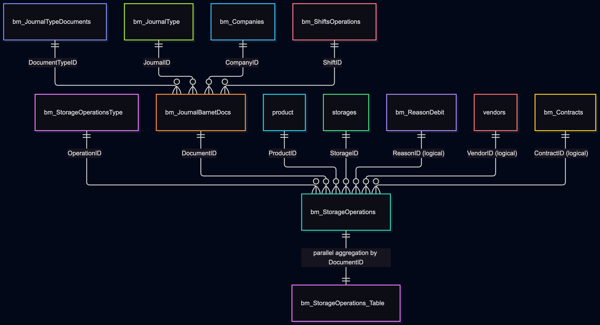

### SQL-валидация связей

**1.1. Проверка связи `OperationID` -> `bm_StorageOperationsType.ID`**
Запрос подтверждает, что все операции имеют корректный тип (физический внешний ключ).
*Результат:* `total_ops = 1031198`, `matched = 1031198`, `diff = 0`.
[Ссылка на SQL-скрипт](./1/1.1.sql)
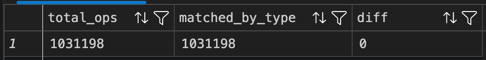

**1.2. Проверка связи `DocumentID` -> `bm_JournalBarnetDocs.ID`**
Подтверждает, что каждая складская операция привязана к документу.
*Результат:* `diff = 0`.
[Ссылка на SQL-скрипт](./1/1.2.sql)
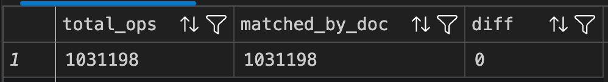

**1.3. Проверка связи `ProductID` -> `product.id`**
Подтверждает, что все движения привязаны к карточке товара.
*Результат:* `diff = 0`.
[Ссылка на SQL-скрипт](./1/1.3.sql)

**1.4. Проверка логической связи `VendorID` -> `vendors.id`**
Запрос показывает, что операции с указанным поставщиком корректно находят его в справочнике.
*Результат:* `matched = 11358`, `diff = 0`.
[Ссылка на SQL-скрипт](./1/1.4.sql)
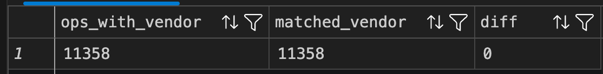

**1.5. Сводка по складам (`StorageID` -> `storages.id`)**
Показывает, на каких складах ведутся операции.
*Результат:* Все 1 031 198 операций привязаны к складу с ID 41 («Склад»).
[Ссылка на SQL-скрипт](./1/1.5.sql)
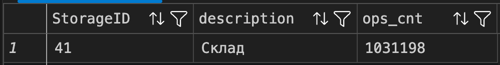

## 2. Анализ продажи товара

**Основная таблица:** `journal` (основная таблица продаж). `bm_Journal_Details` (детализация чеков).
**Связанные таблицы:** `product` (товары), `category` (категории), `clients` (клиенты), `transtype` (типы транзакций), `personnel` (кассиры).

### Описание таблиц и ключевых колонок

| Таблица | Колонка | Назначение | Пример данных |
| :--- | :--- | :--- | :--- |
| **journal** | `transnumber` | Первичный ключ транзакции | `5` |
| | `receiptn` | Номер чека | `90000001` |
| | `dater` | Дата и время продажи | `2024-10-15 14:22:10`|
| | `amount` | Сумма продажи | `50.00` |
| | `id` | Код товара (varchar) | `1204073` |
| | `categoryid` | ID категории (в виде строки) | `174` |
| | `loginid` | Логин кассира | `1` |
| **bm_Journal_Details** | `ID` | Первичный ключ детализации | `12547869` |
| | `SourceID` | Ссылка на `journal.transnumber` | `5` |
| | `ProductID` | Ссылка на товар | `4337` |
| | `Quantity` | Количество | `1.5000` |
| **category** | `id` | Первичный ключ категории | `174` |
| | `categoryid` | Текстовый код | `COCKTAILS` |
| | `description` | Название | `Александр` |

### ER-диаграмма продаж
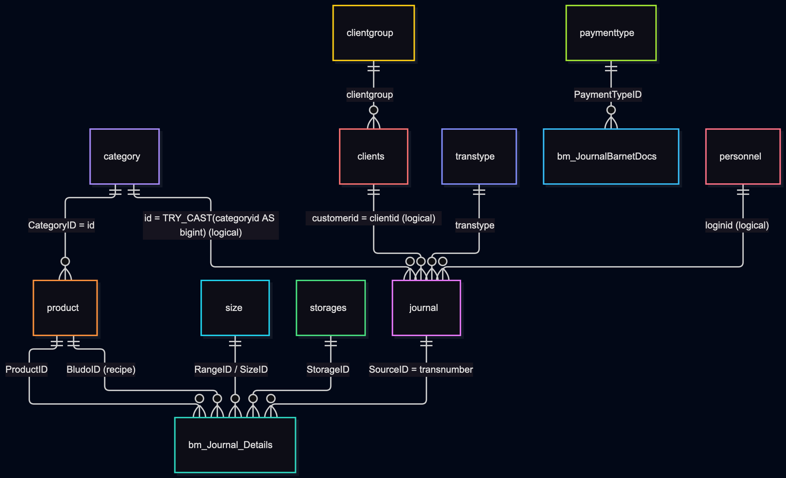

### SQL-валидация связей

**2.1. Проверка связи `SourceID` -> `journal.transnumber`**
Доказывает, что детализация чеков корректно привязана к шапкам чеков.
*Результат:* `matched = 1089641`, `diff = 0`.
[Ссылка на SQL-скрипт](./2/2.1.sql)
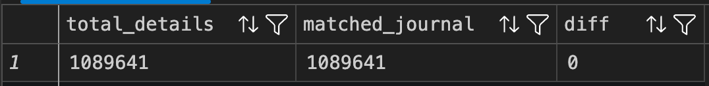

**2.2. Проверка связи `transtype` -> `transtype.transtypeid`**
Все типы транзакций в журнале существуют в справочнике. `diff = 0`.
[Ссылка на SQL-скрипт](./2/2.2.sql)
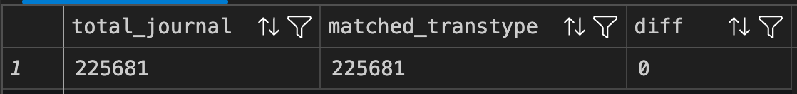

**2.3. Проверка логической связи `journal.id` -> `product.productid`**
Выявлено 15 848 несовпадений. Видимо записи относятся к удаленным когда-то товарам или услугам, которых уже нет в актуальном справочнике `product`.
[Ссылка на SQL-скрипт](./2/2.3.sql)
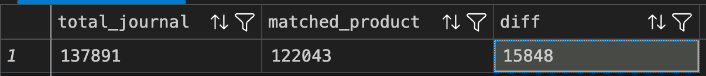

**2.4. Проверка логической связи `journal.categoryid` -> `category.id`**
*Важная особенность:* В `journal` поле `categoryid` хранит числа в строковом виде, а в `category` текстовый код. Прямой JOIN не работал. После применения `TRY_CAST(journal.categoryid AS bigint) = category.id` связь успешно подтвердилась (122 043 совпадения).
[Ссылка на SQL-скрипт](./2/2.4.sql)
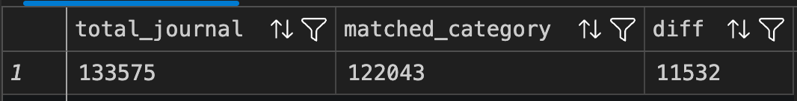

**2.5. Проверка связи `customerid` -> `clients.clientid`**
Из 62 187 чеков с клиентами только 11 содержат ID, которых нет в базе (удаленные карты лояльности). Связь работает.
[Ссылка на SQL-скрипт](./2/2.5.sql)
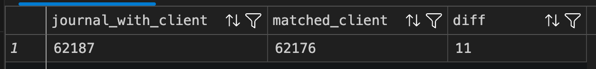

**2.6. Проверка связи `loginid` -> `personnel.personid`**
Все 225 681 транзакций имеют корректную привязку к сотруднику (кассиру), совершившему продажу. `diff = 0`.
[Ссылка на SQL-скрипт](./2/2.6.sql)

---

## 3. Анализ взаимоотношений с поставщиками

**Основная таблица:** `vendors` (справочник контрагентов-поставщиков).
**Связанные таблицы:** `vendorgroup` (группы поставщиков), `bm_Companies` (собственное юрлицо), `bm_StorageOperations` (закупки), `paymenttype` (виды оплат).

### Описание таблиц и ключевых колонок

| Таблица | Колонка | Назначение | Пример данных |
| :--- | :--- | :--- | :--- |
| **vendors** | `id` | Первичный ключ поставщика | `90` |
| | `firstname` | Название контрагента | `ИП Габур` |
| | `INN` | ИНН | `7701234567` |
| | `clientgroup` | Группа поставщика | `32` |
| **vendorgroup** | `vendorgroupid` | Первичный ключ группы | `1` |
| | `description` | Название группы | `Алкоголь` |
| **bm_Companies** | `ID` | ID юрлица | `6` |
| | `CompanyName` | Название | `ИП Лукьянова Анастасия Игоревна` |
| **paymenttype** | `paymenttypeid` | Первичный ключ типа оплаты | `211` |
| | `description` | Название | `Наличные` |

### ER-диаграмма поставщиков
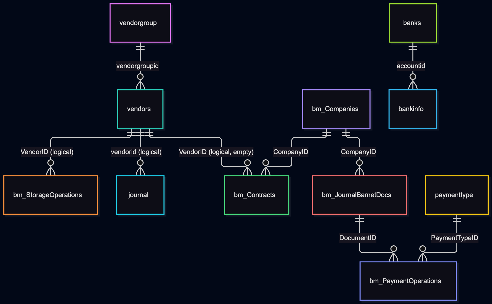

### SQL-валидация связей

**3.1. Проверка связи `clientgroup` -> `vendorgroup.vendorgroupid`**
Все 63 поставщика корректно распределены по группам. `diff = 0`.
[Ссылка на SQL-скрипт](./3/3.1.sql)
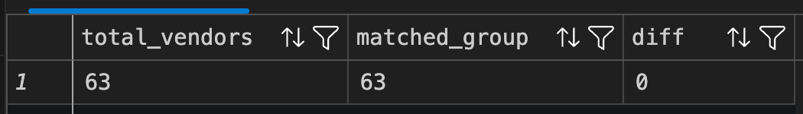

**3.2. Анализ активности поставщиков (LEFT JOIN)**
Запрос показывает, кто из поставщиков реально приносил товары, а кто «спит». Также видны дубликаты карточек (например, ИП Габур заведен дважды под ID 90 и 91).
[Ссылка на SQL-скрипт](./3/3.2.sql)
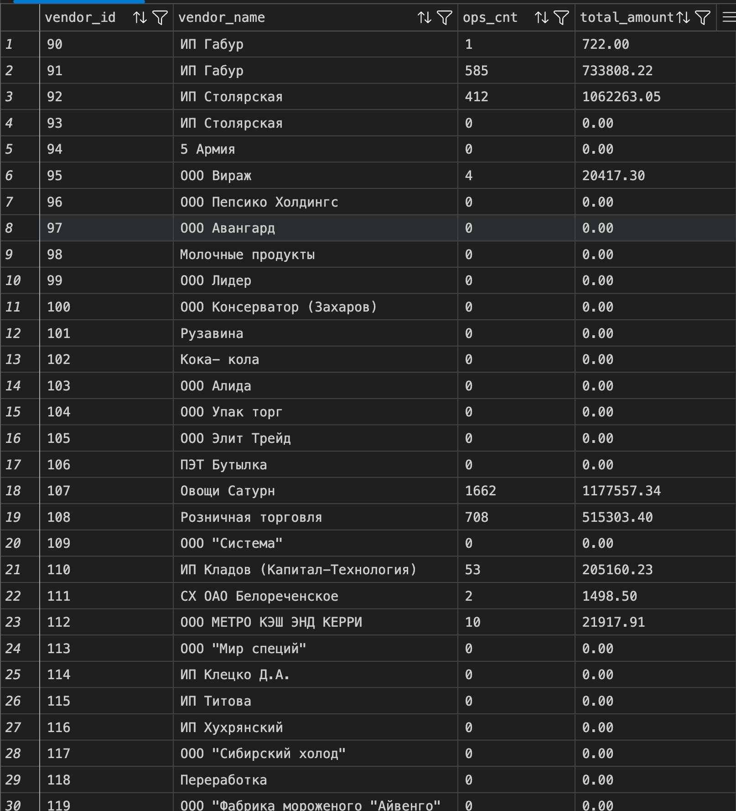

**3.3. Привязка документов к компании (`bm_JournalBarnetDocs.CompanyID` -> `bm_Companies.ID`)**
Все 55 149 документов в системе оформлены от лица одной компании (ID 6).
[Ссылка на SQL-скрипт](./3/3.3.sql)

**3.4. Проверка справочника оплат (`paymenttype` -> `bm_PaymentOperations`)**
Справочник содержит 16 видов оплат, однако таблица операций `bm_PaymentOperations` полностью пуста. Это означает, что в текущем экземпляре БД фиксация оплат через эту таблицу не ведется (устаревший модуль).
[Ссылка на SQL-скрипт](./3/3.4.sql)
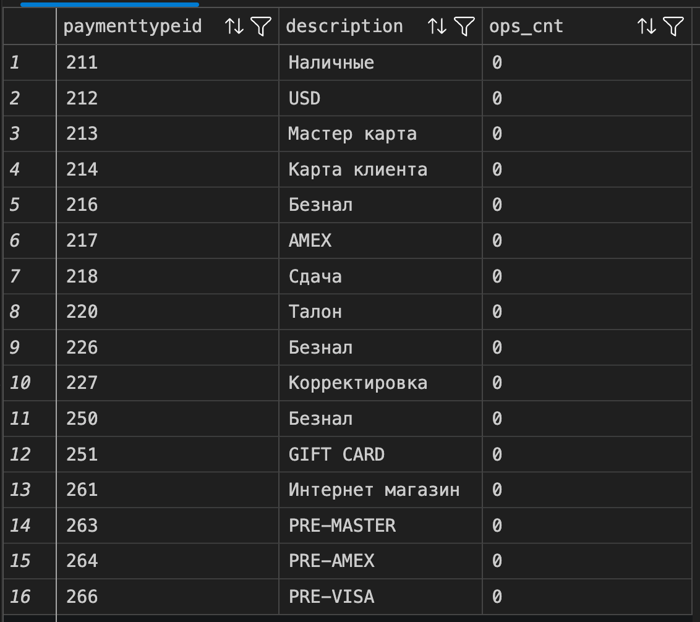

---

## 4. Анализ работы персонала

**Основная таблица:** `personnel` (карточки сотрудников).
**Связанные таблицы:** `bm_PersonnelSecurity` (матрица прав), `bm_SecurityObjects` (объекты), `bm_JournalSessions` (логи действий), `bm_BonusHistory` (бонусы).

### Описание таблиц и ключевых колонок

| Таблица | Колонка | Назначение | Пример данных |
| :--- | :--- | :--- | :--- |
| **personnel** | `personid` | Первичный ключ сотрудника | `897` |
| | `firstname` | Имя | `Татьяна` |
| | `lastname` | Фамилия | `Безик` |
| | `securityaccess` | Уровень доступа (устар.) | `9` |
| **bm_JournalSessions**| `ID` | ID лога | `1` |
| | `PersonID` | Ссылка на сотрудника | `897` |
| | `DateAdd` | Время события | `2019-10-10 10:09:48` |
| **bm_PersonnelSecurity**| `PersonID` | Ссылка на сотрудника | `906` |
| | `ObjectID` | Ссылка на объект доступа | `36` |

### ER-диаграмма персонала
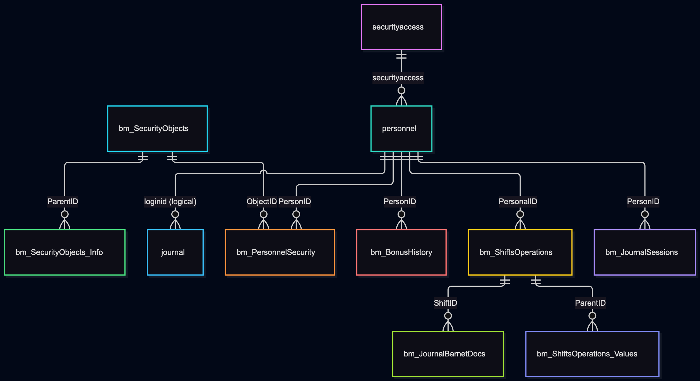

### SQL-валидация связей

**4.1. Проверка связи `securityaccess` -> `securityaccess.securityaccessid`**
Показано, что старый справочник уровней доступа не используется: из 109 сотрудников только у 7 уровень доступа совпадает со справочником, у остальных стоят legacy-коды.
[Ссылка на SQL-скрипт](./4/4.1.sql)
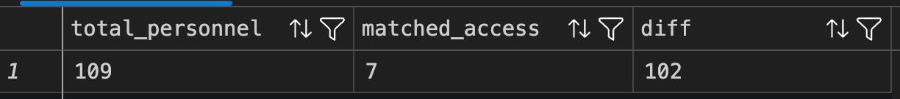

**4.2. Проверка связи `PersonID` -> `personnel.personid` в матрице прав**
Все 1402 записи прав корректно привязаны к сотрудникам. `diff = 0`.
[Ссылка на SQL-скрипт](./4/4.2.sql)
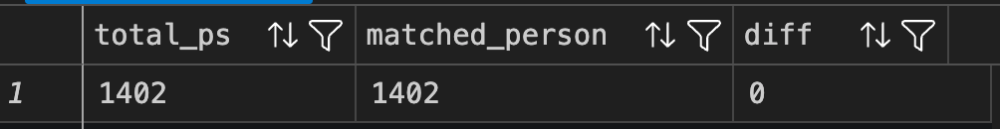

**4.3. Проверка связи `ObjectID` -> `bm_SecurityObjects.ID`**
Все 1402 записи прав ссылаются на существующие системные объекты. `diff = 0`.
[Ссылка на SQL-скрипт](./4/4.3.sql)

**4.4. Проверка связи `PersonID` -> `personnel.personid` в логах**
Из 174 072 записей логов 17 143 относятся к системным процессам (у которых нет привязки к конкретному сотруднику). Остальные 156 929 корректно привязаны к работникам.
[Ссылка на SQL-скрипт](./4/4.4.sql)
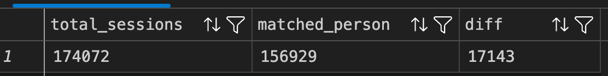

**4.5. Проверка связи `PersonID` -> `personnel.personid` в бонусах**
Все 44 866 начислений бонусов привязаны к сотрудникам. `diff = 0`.
[Ссылка на SQL-скрипт](./4/4.5.sql)

---

## 5. Анализ остатков

**Основная таблица:** `product` карточки товаров, содержащие текущие остатки (`onhandg`).
**Связанные таблицы:** `category` (категории), `size` (единицы измерения), `pricelist` (прайс-листы), `pricegroup` (группы цен), `vendors` (поставщики).

### Описание таблиц и ключевых колонок

| Таблица | Колонка | Назначение | Пример данных |
| :--- | :--- | :--- | :--- |
| **product** | `id` | Первичный ключ | `4337` |
| | `productid` | Артикул / код | `1204073` |
| | `description` | Наименование | `Бананы` |
| | `onhandg` | Текущий остаток на складе | `15.500` |
| | `cost` | Себестоимость | `50.00` |
| | `CategoryID` | Ссылка на категорию | `200` |
| **pricelist** | `id` | ID строки прайса | `113681` |
| | `productid` | Ссылка на товар | `4544` |
| | `basecost` | Базовая цена | `140.00` |
| **size** | `ID` | ID размера/ед. изм. | `42` |
| | `sizeid` | Код | `порция` |

### ER-диаграмма остатков
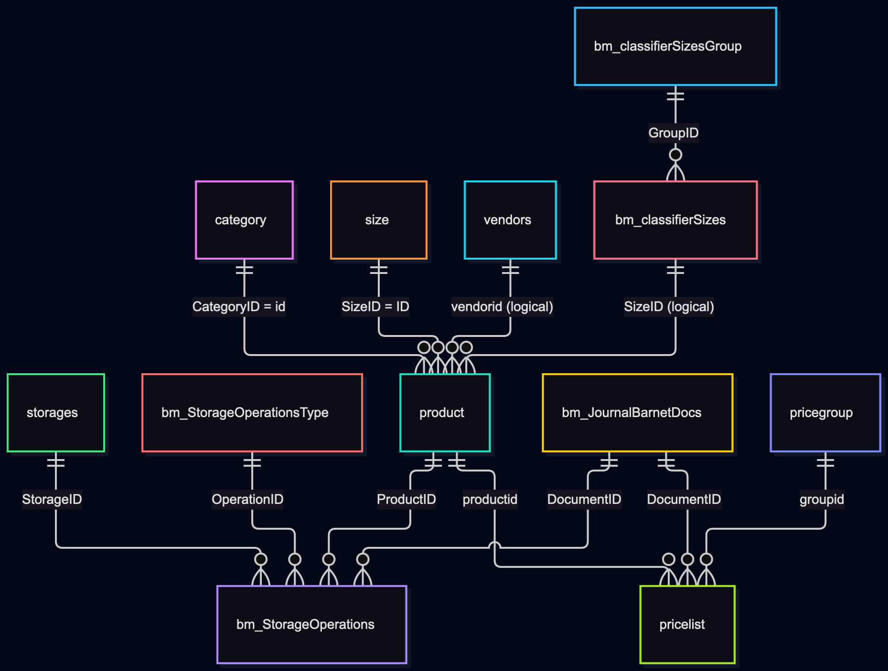

### SQL-валидация связей

**5.1. Проверка связи `CategoryID` -> `category.id`**
Все 1545 товаров имеют корректную категорию (физический внешний ключ). `diff = 0`.
[Ссылка на SQL-скрипт](./5/5.1.sql)
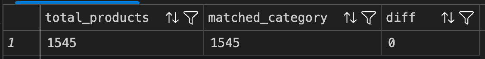

**5.2. Проверка логической связи `SizeID` -> `size.ID`**
Все товары имеют корректно указанную единицу измерения. `diff = 0`.
[Ссылка на SQL-скрипт](./5/5.2.sql)

**5.3 проверка связи `bm_StorageOperations.ProductID` -> `product.id` для контроля остатков**
полностью дублирует запрос **1.3** из раздела «Анализ закупки продукции». 
Во избежание дублирования кода и скриншотов, результаты этой проверки описаны в п. 1.3.

**5.4. Проверка связи `vendorid` -> `vendors.id` в товарах**
В выборку попал только 1 товар (фильтр `vendorid != 0`, так как у большинства товаров поставщик не указан). Связь работает без ошибок.
[Ссылка на SQL-скрипт](./5/5.4.sql)
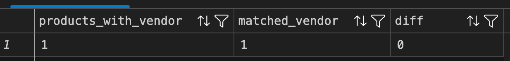

**5.5. Проверка связи `productid` -> `product.id` в прайс-листах**
Все 24 797 записей прайс-листов ссылаются на существующие товары. `diff = 0`.
[Ссылка на SQL-скрипт](./5/5.5.sql)
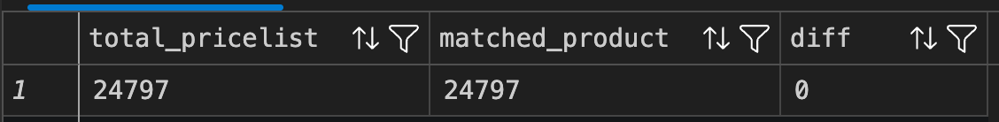

**5.6. Проверка связи `groupid` -> `pricegroup.pricegroupid`**
Все 24 797 записей прайс-листов привязаны к группам цен (Закупочная/Розничная). `diff = 0`.
[Ссылка на SQL-скрипт](./5/5.6.sql)
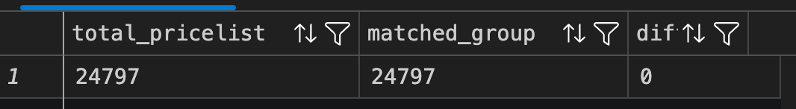